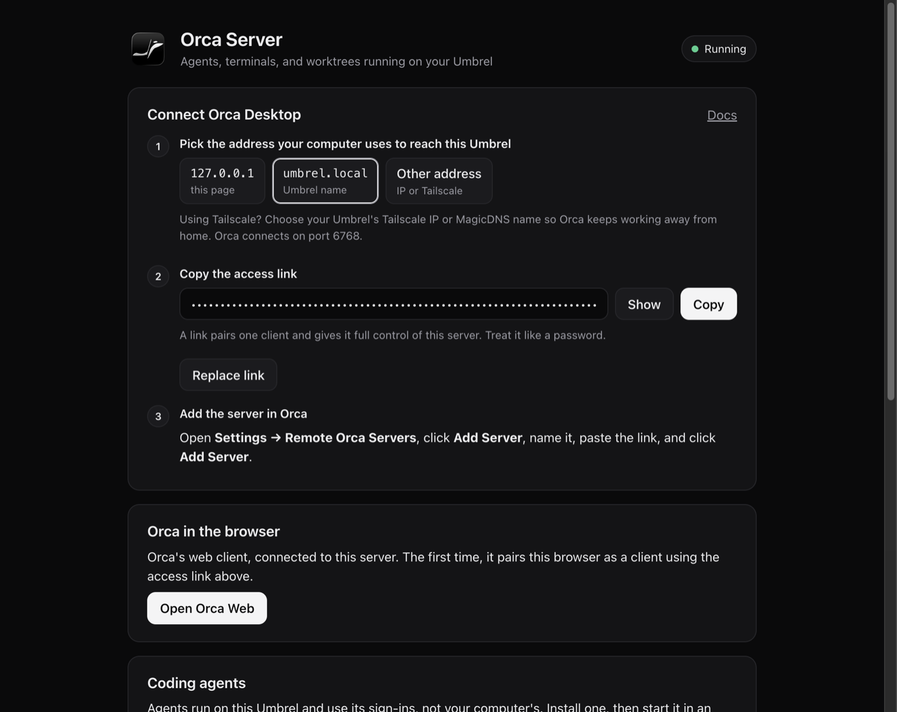
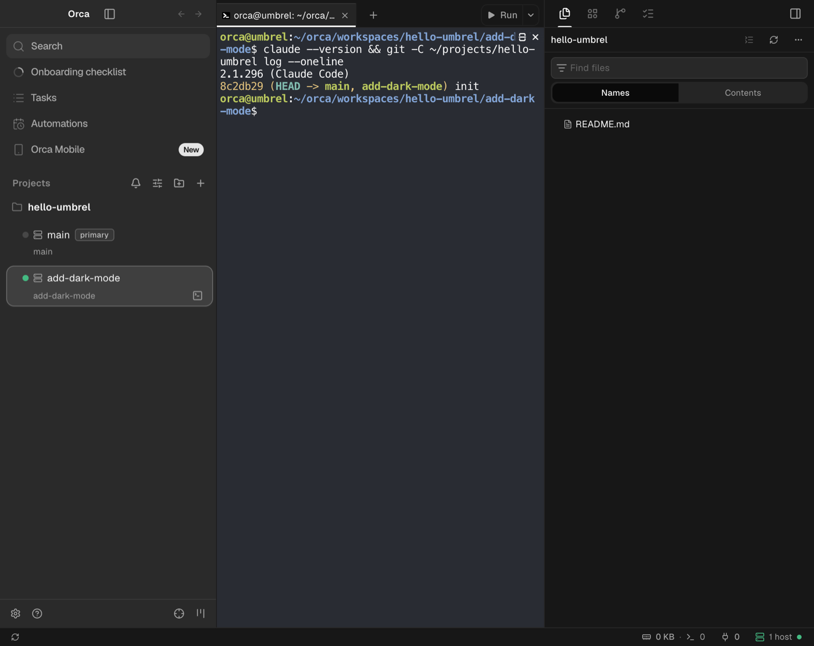

# Orca Server for umbrelOS

[](https://github.com/yanffernandes/umbrel-orca-server/actions/workflows/ci.yml)
[](https://github.com/yanffernandes/umbrel-orca-server/actions/workflows/release.yml)

Run a headless [Orca](https://github.com/stablyai/orca) server on your
[Umbrel](https://umbrel.com). Projects, worktrees, terminals, and coding agents live on the
Umbrel and keep running while your laptop sleeps. You drive them from the Orca desktop app
or from Orca's web client in any browser.



This repository is an Umbrel community app store with one app, plus the source of its
container image. Contributions are welcome; see [CONTRIBUTING.md](CONTRIBUTING.md).

## Contents

- [Install](#install)
- [Connect Orca](#connect-orca)
- [Coding agents](#coding-agents)
- [What is kept](#what-is-kept)
- [Security](#security)
- [How it works](#how-it-works)
- [Contributing](#contributing)
- [Official Umbrel App Store](#official-umbrel-app-store)
- [Credits and license](#credits-and-license)

## Install

1. In umbrelOS, open the **App Store**, click **⋯** (top right), then **Community App Stores**.
2. Paste `https://github.com/yanffernandes/umbrel-orca-server` and click **Add**.
3. Open the **Yan Fernandes** store and install **Orca Server**.

The image supports `amd64` (Umbrel Home, x86 PCs) and `arm64` (Raspberry Pi 4 and 5).
The first start downloads Orca's runtime and takes about a minute.

## Connect Orca

1. Open **Orca Server** from the Umbrel home screen and sign in with the app password
   umbrelOS shows you.
2. Pick the address your computer uses to reach the Umbrel: `umbrel.local` on your home
   network, or the Umbrel's Tailscale IP or MagicDNS name to also work away from home.
3. Copy the access link.
4. In Orca, open **Settings → Remote Orca Servers → Add Server**, paste the link, and add it.

Each link pairs one client. Use **Create new link** to pair another computer, and
**Revoke** under **Paired clients** to cut one off. Terminals and agents keep running
through both.

**Open Orca Web** opens Orca's browser client, connected through the app's own address, so
it also works when umbrelOS serves the app over HTTPS.



The server does not need to run the same Orca version as your desktop: Orca keeps
clients and servers compatible across versions, and newer features say when they need a
newer server.

## Coding agents

Agents run on the Umbrel, with the Umbrel's own sign-ins. Install Claude Code, Codex, or
OpenCode from the app page, or any other CLI from an Orca terminal, then sign in by
starting it in an Orca terminal on the server: `claude`, `codex login --device-auth`, or
`opencode auth login`. For GitHub, run `gh auth login`.

The container has git, the GitHub CLI, Node.js 24, Python 3, build tools, and passwordless
`sudo` for installing system packages.

## What is kept

Everything under the home directory, `/home/orca`, which lives in the app's data folder:
Orca's state and paired clients, cloned repositories and worktrees, agent CLIs and their
sign-ins, and shell and git configuration. Packages installed with `sudo apt-get` are gone
when the container is recreated, which happens on app updates.

## Security

- Orca clients connect directly to port **6768**. Every client authenticates with its own
  revocable token from an access link. Keep the port on your LAN or tailnet, and do not
  forward it to the internet.
- An access link gives full control of the server, including a shell. Treat it like a
  password.
- The status page is behind umbrelOS's login and also asks for the app's own password,
  because other containers on the Umbrel can reach it without going through the login.

Report vulnerabilities privately; see [SECURITY.md](SECURITY.md).

## How it works

```text
 Your computer                                Umbrel
┌─────────────────────┐              ┌──────────────────────────────────────────────┐
│ Orca Desktop        │  ws :6768    │ orca-ide serve → orcad (Orca's Node runtime) │
│ (Remote Orca Server)├─────────────►│   projects · worktrees · terminals · agents  │
└─────────────────────┘              │                     ▲                        │
┌─────────────────────┐  http :6769  │                     │ WebSocket relay        │
│ Browser             ├─────────────►│ companion (Node.js, :8080)                   │
│ (behind Umbrel login)              │   status page · access links · Orca Web      │
└─────────────────────┘              │   agent installs · paired clients            │
                                     │                                              │
                                     │ /home/orca  ⇐  ${APP_DATA_DIR}/data/home     │
                                     └──────────────────────────────────────────────┘
```

The image installs the official `orca-ide` Linux package and runs `orca-ide serve`, which
starts orcad on port 6768. A small companion app in [`image/companion`](image/companion)
(plain Node.js, no dependencies) supervises it and serves the status page on port 8080,
which umbrelOS exposes as the app on port 6769. The companion:

- reads the pairing offer Orca prints at startup and rewrites its address for the client;
- mints new links and revokes clients by restarting orcad around an edit of Orca's client
  registry. Terminals survive, because Orca's terminal daemon keeps running;
- serves Orca's web client bundle and relays its WebSocket to orcad;
- installs agent CLIs into the persistent home.

Two workarounds live in the [Dockerfile](image/Dockerfile):

- Orca 1.4.224 keeps the file `orca-ide serve` uses to pick orcad inside `app.asar`, out
  of reach of the CLI, so serve falls back to Electron, whose sandbox cannot start in
  Docker ([stablyai/orca#27307](https://github.com/stablyai/orca/issues/27307)). The
  image copies that file out, and stops once Orca ships it unpacked.
- Orca only bundles the web client for Electron serve, so the image copies it out for
  the companion to serve.

## Contributing

Bug reports, fixes, and ideas are welcome. Problems with Orca itself belong in
[stablyai/orca](https://github.com/stablyai/orca/issues); problems with installing,
pairing, the status page, the image, or updates belong here.

To work on it you need Docker and Node.js 24:

```sh
node --test image/companion/test/*.test.mjs   # unit tests
scripts/local-test.sh                         # build and run at http://localhost:16769
scripts/smoke-test.sh umbrel-orca-server:local
```

[CONTRIBUTING.md](CONTRIBUTING.md) covers the layout, the rules the code follows, and
how releases reach Umbrel. If you work with a coding agent, point it at
[AGENTS.md](AGENTS.md).

## Official Umbrel App Store

The app is not in the official Umbrel App Store yet. Getting there means a pull request to
[getumbrel/umbrel-apps](https://github.com/getumbrel/umbrel-apps), reviewed by the Umbrel
team, with every update going through review as well.
[`scripts/make-official-package.py`](scripts/make-official-package.py) builds that
package from this one; CONTRIBUTING.md describes the steps.

## Credits and license

Orca is made by [Stably AI](https://github.com/stablyai) and released under the MIT
license; the app icon is Orca's. This repository packages it for umbrelOS and is not
affiliated with Stably AI or Umbrel.

The packaging in this repository is released under the [MIT license](LICENSE).
